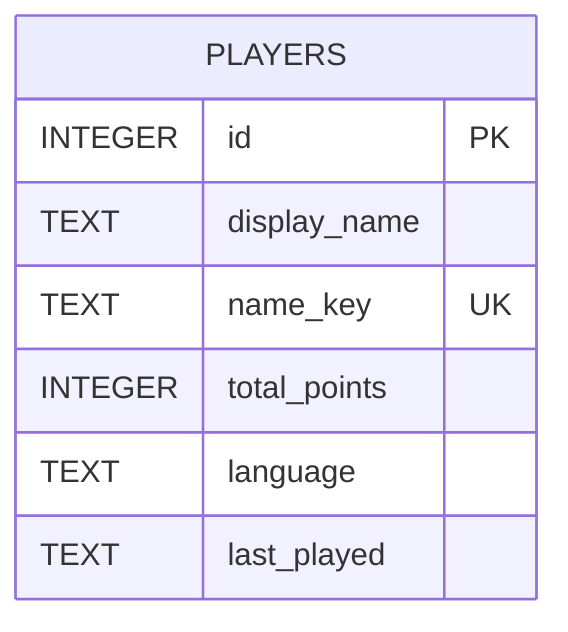
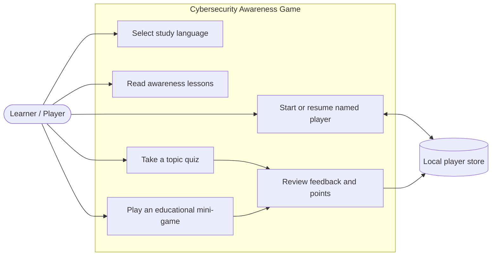
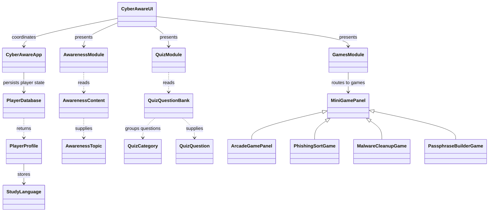
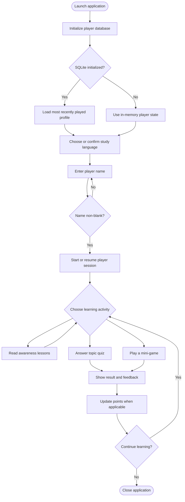
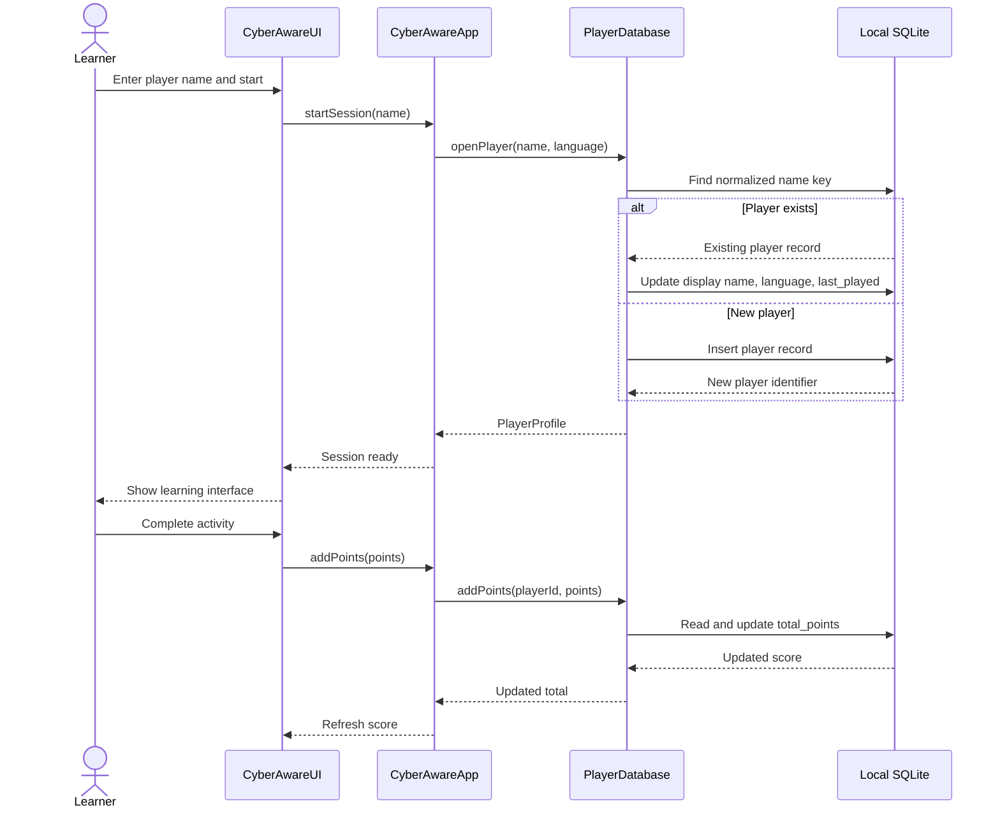

# Design Diagrams

The diagram source files use Mermaid and are editable text. GitHub renders the Mermaid blocks below when this Markdown page is viewed there. Standalone PNG exports are not included: no local Mermaid-to-PNG rendering tool or supplied diagram images were available during this organization. The blocks here provide a rendered GitHub view while keeping the corresponding `.mmd` source files editable.

## Entity-relationship diagram

Source: [`ER-Diagram.mmd`](./ER-Diagram.mmd). This diagram reflects the single `players` table in the Java-created SQLite schema.

## Use-case diagram

Source: [`Use-Case-Diagram.mmd`](./Use-Case-Diagram.mmd). Learner activities and local storage are based on the existing UI, README, and player persistence code.

## Class diagram

Source: [`Class-Diagram.mmd`](./Class-Diagram.mmd). The class names and module relations correspond to the current Java packages; the diagram is intentionally limited to documented dependencies.

## Activity diagram

Source: [`Activity-Diagram.mmd`](./Activity-Diagram.mmd). Startup, player-name validation, persistence fallback, and activity selection are represented from the existing entry point and application code.

## Sequence diagram

Source: [`Sequence-Diagram.mmd`](./Sequence-Diagram.mmd). This describes player opening and score persistence as implemented through `CyberAwareApp` and `PlayerDatabase`.

