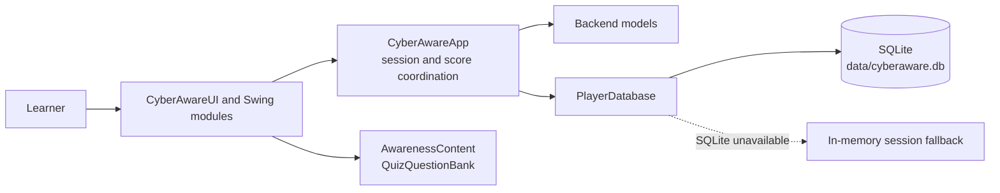

# System Architecture

## Overview

The application is a local Java Swing desktop program. The UI delegates session and persistence work to `CyberAwareApp`, while content repositories provide lesson and quiz data. SQLite stores local player state when the JDBC driver and database are available; the backend also has an in-memory fallback for the current session.

## Responsibilities

| Component | Responsibility |
|---|---|
| `CyberAwareUI` and frontend modules | Present navigation, lessons, games, quiz interactions, results, and theming |
| `CyberAwareApp` | Coordinate player session, selected language, score, and UI startup |
| `AwarenessContent` / `QuizQuestionBank` | Supply educational text and quiz question data |
| Backend models | Represent player profiles, topics, questions, categories, languages, and arcade entities |
| `PlayerDatabase` | Initialize SQLite storage, load/open players, update language, and persist points; retain a session-only fallback when SQLite is unavailable |

The application is launched through `com.cyberaware.backend.CyberAwareApp`. The standard Windows scripts compile the source and execute that main class; Maven configures the same entry point for the packaged JAR.

## Data boundary

Player data is stored locally. The project does not document or implement a remote service, user account service, or server-side database in the inspected source.
