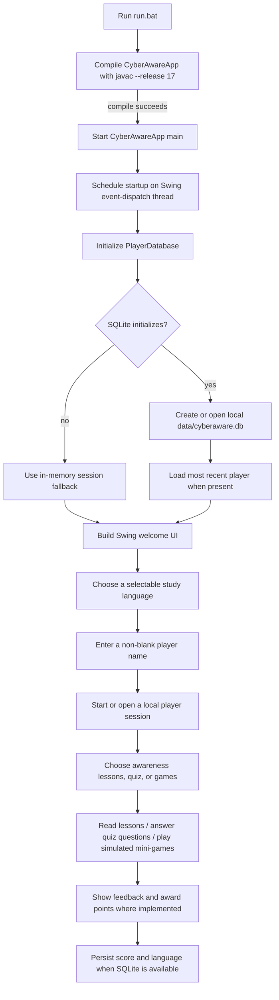

# Week 01 — Initial System Flow

> This flow is derived from the current source and Windows launcher. It describes the code path; it is not a claim that every UI action was exercised during testing.

## Startup and learner flow

## Component responsibilities

| Component | Responsibility in the inspected source |
|---|---|
| `CyberAwareApp` | Entry point and session coordination; creates the player database and starts the Swing UI. |
| `CyberAwareUI` | Welcome screen and navigation between application sections. |
| `AwarenessModule` / `AwarenessContent` | Render educational topics and their advice, examples, and checklists. |
| `QuizModule` / `QuizQuestionBank` | Provide category-based quiz interaction and feedback. |
| `GamesModule` and game panels | Present the four simulated practice games. |
| `PlayerDatabase` | Read/write local SQLite player profiles and points, or retain fallback state in memory. |

## Initial data model

The persisted `players` table contains `id`, `display_name`, unique normalized `name_key`, `total_points`, `language`, and `last_played`. See the existing [database schema](../../../database/schema.sql) and [ER diagram](../../design/ER-Diagram.mmd).

## Related design documents

- [System architecture](../../design/system-architecture.md)
- [Diagram gallery](../../design/diagrams.md)
- [Class diagram](../../design/Class-Diagram.mmd)
- [Sequence diagram](../../design/Sequence-Diagram.mmd)
- [ER diagram](../../design/ER-Diagram.mmd)

## Navigation

- [Week 01 report](./README.md)
- [Requirements](./requirements.md)
